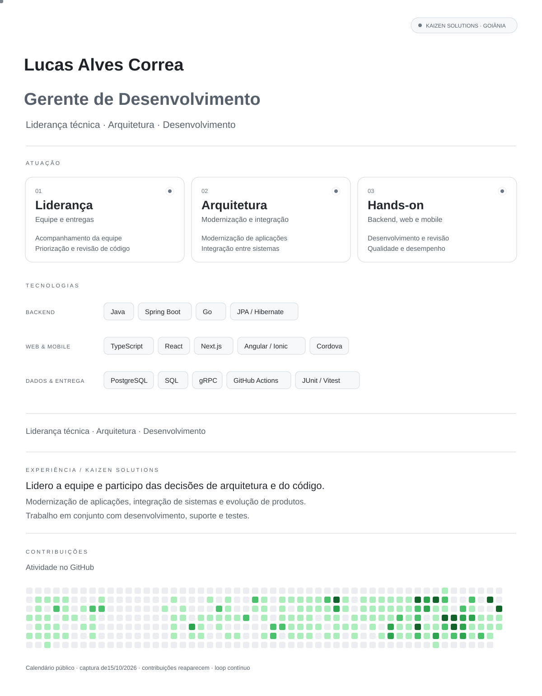

<a href="#experiência"><picture>
  <source media="(prefers-color-scheme: dark)" srcset="assets/profile-dark.svg">
  <source media="(prefers-color-scheme: light)" srcset="assets/profile-light.svg">
  
</picture></a>

Experiência e tecnologias — versão em texto

### Experiência

**Gerente de Desenvolvimento · Kaizen Solutions**

Liderança da equipe e acompanhamento de entregas. Arquitetura, modernização de aplicações, revisão de código e desenvolvimento backend, web e mobile. Colaboração com suporte e testes na evolução dos produtos.

Java, Spring Boot, Go, JPA/Hibernate, TypeScript, React, Next.js, Angular/Ionic, Cordova, PostgreSQL, SQL, gRPC, GitHub Actions, Maven, JUnit e Vitest.

[Goiânia, Brasil · Kaizen Solutions](https://github.com/kaizensolutions-ti)
