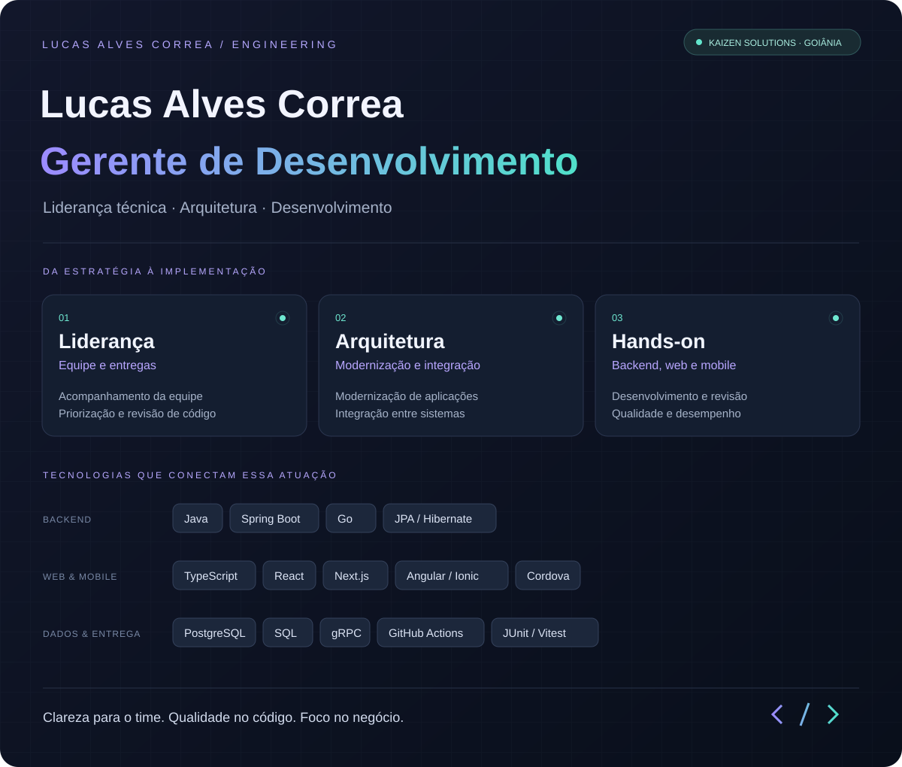

### Liderança técnica com atuação no código.

Sou **Gerente de Desenvolvimento na Kaizen Solutions**. Lidero a equipe e atuo em arquitetura, modernização de aplicações e desenvolvimento backend, web e mobile.

### Experiência

**Gerente de Desenvolvimento · Kaizen Solutions**

- Liderança da equipe de desenvolvimento e acompanhamento de entregas.
- Definição de soluções técnicas, revisão de código e modernização de aplicações.
- Desenvolvimento de serviços backend, aplicações web e mobile e integrações entre sistemas.
- Colaboração com suporte e testes na investigação de problemas e evolução dos produtos.

**Goiânia, Brasil** · [Kaizen Solutions](https://github.com/kaizensolutions-ti)
